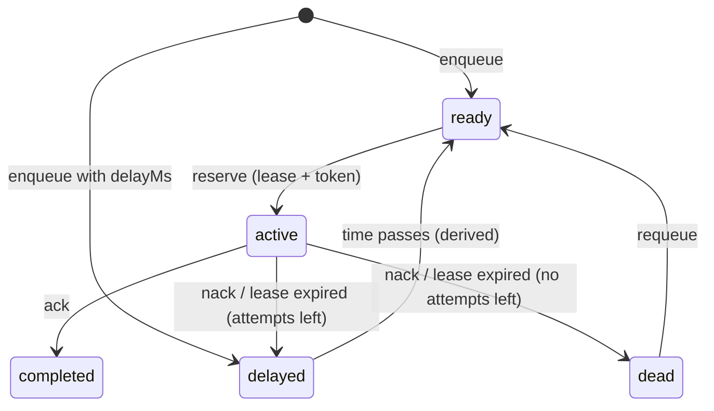

# Architecture and design decisions

## 1. Job state machine

## 2. Event sourcing with one reducer

Every mutation is an immutable event (`enqueue`, `reserve`, `heartbeat`, `ack`, `retry`, `dead`,
`requeue`, `snapshot`). A commit is always:

1. append the events to the WAL (one write, one `fsync`)
2. apply them to memory through the single `#apply` reducer

Startup replays the log through the same reducer, then rebuilds the heaps from job states.
Because live and recovery paths share one code path, they cannot disagree.
If step 1 throws, memory is untouched, so the queue never claims something it did not persist.
Callers that popped heap entries (`reserve`, `tick`) put them back on failure.

**Derived state is not logged.** `delayed -> ready` depends only on time, so it is recomputed
after restart rather than written. That halves log traffic for retry-heavy workloads.

## 3. Leases and fencing

`reserve` gives the worker a random token and a deadline. `ack`/`nack`/`heartbeat` must present the
token of the *current* lease. If a lease expires, the job is retried and gets a new token, so a slow
"zombie" worker that wakes up later is rejected (`409`). Without fencing, two workers could both
believe they own a job.

Expired leases are found with a min-heap keyed by deadline. Heartbeats push a new entry and leave the
old one; when an old entry is popped it is recognized as stale (deadline or token no longer matches) and
skipped. This lazy deletion keeps heartbeats O(log n) without a decrease-key operation.

## 4. Delivery semantics

At-least-once. The unavoidable window: a worker finishes the work and crashes before `ack`. The job
will run again. Exactly-once processing is not achievable by the queue alone; handlers should be
idempotent (for example, keyed by `job.id`). `idempotencyKey` only protects *enqueue* from duplicates.

An `ack` that arrives after the lease deadline but before the reaper noticed is accepted. The work is
done, so rejecting it would only cause a pointless retry.

## 5. Write-ahead log format

`<crc32 hex>\t<json>\n` per record.

| Situation | Behavior | Why |
|---|---|---|
| Final line incomplete or bad checksum | truncate and continue | a crash during append produces exactly this |
| Bad line followed by valid lines | refuse to start (`CorruptLogError`) | bit rot or tampering; silently skipping would lose acknowledged data |

Truncation happens *before* new appends so a partial line can never be glued to a fresh record.

**Compaction** writes a snapshot of live state to a temp file, `fsync`s it, renames it over the log
(atomic on POSIX), and `fsync`s the directory. A crash leaves either the complete old log or the
complete new one. It triggers when the log has at least `compactMinRecords` records and more than 4x the
number of live jobs. Active jobs keep their tokens in the snapshot, so in-flight leases survive restarts.

## 6. Complexity

| Operation | Cost |
|---|---|
| enqueue, reserve, heartbeat | O(log n) plus one WAL append |
| tick | O(k log n) for k due entries |
| stats | O(1) (counters maintained in the reducer) |
| compaction | O(n), amortized over at least 3n appended records |

## 7. Trade-offs I made on purpose

- **Synchronous `fsync` per commit.** Simple and easy to reason about; throughput is bounded by disk
  latency. The next step is group commit (batching concurrent requests into one fsync).
- **Everything live is in memory.** Fast and simple; capacity is bounded by RAM. Completed history is capped
  (`completedRetention`), which also bounds idempotency-key memory.
- **Single process.** No replication, so a dead disk means lost jobs. Documented, not hidden.
- **Equal jitter backoff** (half fixed, half random) rather than full jitter: it keeps a minimum wait so a
  failing dependency is not hit again instantly, while still de-synchronizing retries.
- **No third-party dependencies.** Nothing to audit, nothing to break; also the clearest demonstration
  of the underlying mechanics.

## 8. Security notes

Constant-time bearer token comparison (hashed first so lengths match), request body size limit with a
clean `413`, payload size limit, strict input validation, tokens never returned from `GET /jobs/:id`,
and the CLI binds to `127.0.0.1` by default (it warns if you expose it without a token).

## 9. Dashboard and job listing

The optional web dashboard is served by the same HTTP process from `public/index.html`; it has no build step, third-party runtime dependency, or external asset requirement. The browser holds the bearer token in page memory only. The authenticated `GET /jobs` endpoint returns newest-first retained job views and intentionally uses the same token-redacting view as `GET /jobs/:id`. Listing is bounded (`limit` 1–200) and supports state filtering and offset pagination. The dashboard polls stats and recent jobs every five seconds; this is an operational convenience, not a substitute for metrics collection or alerting.
